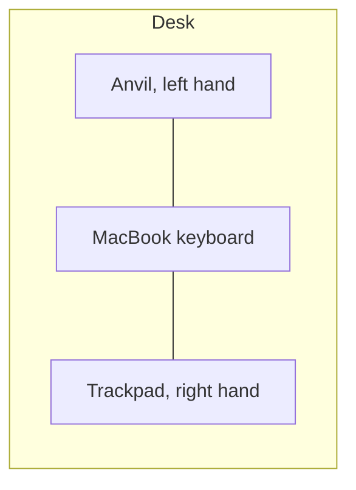
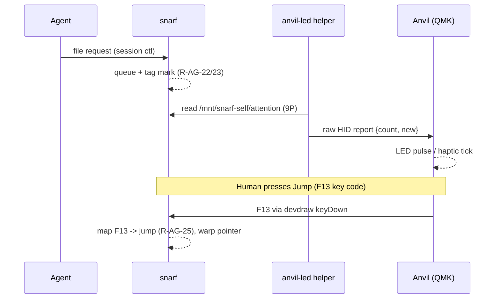

# Anvil: hardware and form-factor design (DRAFT)

**Status: DRAFT / PARKED. Documentation only. Nothing has been purchased or built.**
Author: SnarfProdd, 2026-10-30, at Larry's request ("research a hardware component and form factor to make a design. Just document for now").
Parked until the M5 attention feature (R-AG-22..27, [M5 draft](../requirements/m5-ai-harness-requirements-draft.md) §5a) exists. Anvil is an optional input profile ([input guide §3a](../input/input-mapping-guide.md)); it is never a requirement.

Evidence tags, as in the input guide: **[V]** verified this session (source opened or code read), **[L]** Larry said so, **[I]** inference to be checked. Prices were read on 2026-10-30 from the linked pages; they change. "Price not verified" means no page confirmed it.

---

## 0. Ground rules (carried over from §3a, unchanged)

1. **Laptop parity.** Every Anvil action is also a binding on a bare MacBook (the left-hand key cluster, §3a). Nothing is Anvil-only.
2. **No three-finger gestures** anywhere, because Larry uses macOS three-finger drag [L].
3. **Off-hand device, mirrorable.** The left hand is on the Anvil and the right hand is on the trackpad or mouse. The layout flips for a left-handed pointer user in firmware or the configurator; snarf sees the same codes either way.
4. **No drivers or private APIs inside snarf.** Configurators and the LED helper run outside snarf.

## 1. Requirements

| # | Requirement | Notes |
|---|---|---|
| HW-1 | **Keys: 5 main keys** under the fingers, plus **1-2 thumb keys** | Five keys give Engelbart's chord space: 2^5 - 1 = **31 chords** ([Doug Engelbart Institute, 1968 demo](https://dougengelbart.org/content/view/374); [CHM Alto chord keyset](https://www.computerhistory.org/collections/catalog/102635868)) [V]. Single presses carry the four core actions; chords are reserved for later, not required. |
| HW-2 | **Core actions on single keys** | Jump (R-AG-25), Approve and Deny (R-AG-22), Back (R-AG-26). They must never require a chord, so the laptop cluster can mirror them 1:1. |
| HW-3 | **Chording in firmware** | QMK [Combos](https://docs.qmk.fm/features/combo) / ZMK [combos](https://zmk.dev/docs/keymaps/combos) [V]. Each chord emits one ordinary key code, so snarf never parses chords from the pad. |
| HW-4 | **Cycler: rotary encoder (EC11) or touch strip** | Turn = next/previous pending request (repeat jump, R-AG-25); press = Back. QMK [encoders](https://docs.qmk.fm/features/encoders) [V]. A touch strip is a later option; an encoder has detents, so each click is one request. |
| HW-5 | **Status feedback** | One LED (or the RGB on the pad): off = queue empty, steady = pending requests, pulse = new request. Optional haptic tick on a new request (DRV2605L, [QMK haptic feedback](https://docs.qmk.fm/features/haptic_feedback)) [V]. **Driven by the host**, which reads the attention queue file (R-AG-24); the pad has no knowledge of snarf. The LED never steals focus (R-AG-27). |
| HW-6 | **Connection: wired USB-C first**, Bluetooth LE optional | Wired is simpler for raw HID (LED control) and has no battery. BLE needs nRF52840 + ZMK (§2). |
| HW-7 | **Weight and grip** | 400-700 g with a non-slip base, so it doesn't creep when chorded (the name is the spec). Reference point: the Keychron Q0 Max weighs 684 ± 10 g ([Keychron](https://www.keychron.com/products/keychron-q0-max-qmk-custom-number-pad)) [V]. |
| HW-8 | **Mirrorable** | Symmetric shell, or a firmware layout flip with relabelled caps. |
| HW-9 | **Mouse buttons: optional, 1-3 only** | See §4.1: the pad **must not** send HID mouse buttons 4 and up. |

## 2. Build paths compared

Legend for the B1-B3 column: "real buttons" means the device can emit HID mouse-button 1/2/3 reports. In every path the safer choice is to send **modifier keys or real buttons 1-3**, never buttons 4+ (§4.1).

### 2.1 Off-the-shelf

| Product | Keys / controls | Price (2026-10-30) | Firmware / config | Real mouse buttons (B1-B3) | Host can drive LEDs | macOS | Fit |
|---|---|---|---|---|---|---|---|
| [Elgato Stream Deck MK.2](https://www.elgato.com/us/en/p/stream-deck) | 15 LCD keys, no encoder | $149.99 list at Elgato; $119.99 at [Amazon](https://www.amazon.com/Elgato-Stream-Deck-MK-2-Controller/dp/B09738CV2G) [V] | Vendor app + [plugin SDK](https://docs.elgato.com/streamdeck/sdk/guides/keys/); or [python-elgato-streamdeck](https://python-elgato-streamdeck.readthedocs.io/en/stable/) over HID | **No** natively; a plugin or helper would have to synthesise clicks [I] | **Yes, best in class**: each key is a screen; set images from the host [V] | Yes (macOS 13+) | Great status display; poor chording (no firmware combos); needs the vendor app or a custom host daemon to emit anything. |
| [Work Louder Creator Micro 2](https://worklouder.cc/creator-micro-2) | 13 keys, encoder, touch sensor, joystick | $198 ([shop](https://work-louder.myshopify.com/products/creator-micro-v2)); Base from $149, Pro from $179 ([FAQ page](https://worklouder.cc/framer-creator-micro)) [V] | Vendor "Input" configurator; **not QMK/VIA** [V] | Not verified | Not verified (closed firmware) | Yes [V] | Marketed as an "AI agent controller" [V], but closed firmware rules out raw HID LED control. |
| [Keychron Q0 Max](https://www.keychron.com/products/keychron-q0-max-qmk-custom-number-pad) | 26 keys + knob, numpad layout | $129.99 listed (earlier $109 barebone / $119 assembled per [Greenkeys](https://green-keys.info/en/keyboard/keychron-q0-max/)) [V] | **QMK + VIA**, open source | Yes via QMK [mouse keys](https://docs.qmk.fm/features/mouse_keys) (`MS_BTN1..3`) [V], after reflashing | Yes, with a custom QMK build ([raw HID](https://docs.qmk.fm/features/rawhid)) [I: needs Keychron's QMK fork] | Yes [V] | Heavy (684 g) aluminium = "Anvil" weight out of the box. Numpad shape is not an Engelbart arc. Wired, BT and 2.4 GHz. |
| [Adafruit MacroPad RP2040](https://www.adafruit.com/product/5128) | 12 keys (3x4), encoder, OLED, per-key RGB | $49.95 kit / $34.95 [bare bones](https://www.adafruit.com/product/5100); **both out of stock** 2026-10-30 [V] | CircuitPython/KMK, or QMK ([`adafruit/macropad`](https://github.com/qmk/qmk_firmware/tree/master/keyboards/adafruit/macropad)) [V] | Yes (QMK or KMK [mouse keys](https://github.com/KMKfw/kmk_firmware/blob/main/docs/en/mouse_keys.md)) [V] | Yes: QMK raw HID drives the RGB/OLED [I: our firmware code] | Yes [I] | **Best cheap prototype** if in stock: open firmware, encoder, LEDs and a screen for the request count. Light; needs a weight. |
| [Keebio BDN9 Rev. 3](https://keeb.io/products/bdn9-rev-3-pcb-3x3-9-key-macropad-rotary-encoder-and-rgb) | 9 keys (3x3), up to 3 encoders, RGB | $25.99 (PCB; switches, caps, case extra) [V] | QMK + VIA [V] | Yes via QMK [I: same as above] | Yes via raw HID [I] | Yes [I] | Cheapest QMK option; requires assembly (soldered encoders). |
| [Koolertron 23-key one-handed keypad](https://www.koolertron.com/koolertron-one-handed-macro-mechanical-keyboard-with-23-fully-programmable-keys.html) | 23 keys, 4 layers, no encoder | From $62.99 [V] | Closed; vendor app ([downloads](https://www.koolertron.com/user-manual-software-download)) [V] | Not verified | **No** (only backlight brightness in the app) [V] | Yes, with the vendor Mac app [V] | Fine as a 1-day ergonomic test of a one-hand cluster; dead end for LED feedback. |
| [Twiddler 4](https://www.tekgear.com/twiddler-4-wrap.html) (reference) | One-hand chording keyboard + mouse | US$229 [V] | Vendor | Has a built-in mouse [V] | Not verified | Bluetooth [V] | Closest modern chord device; handheld, not desk-rested. Reference only. |

### 2.2 Maker build (hand-wired or simple PCB)

| Part | Example | Price (2026-10-30) | Notes |
|---|---|---|---|
| MCU (wired, RP2040) | [Seeed XIAO RP2040](https://www.seeedstudio.com/XIAO-RP2040-v1-0-p-5026.html) | $3.99 [V] | 11 GPIO: enough for 5+2 keys direct-wired + encoder (3 pins) + 1 LED [I: pin count to confirm] |
| MCU (wired, RP2040, Pro Micro footprint) | [Adafruit KB2040](https://www.adafruit.com/product/5302) | $9.95 [V] | More pins, keyboard-oriented, QMK/KMK |
| MCU (BLE) | nice!nano v2 (nRF52840) | $27 at [keebd](https://keebd.com/en-us/products/nice-nano) (sold out); $41 at [Custom KBD](https://customkbd.com/collections/microcontrollers) [V] | ZMK; mouse emulation via [`&mkp LCLK/MCLK/RCLK`](https://zmk.dev/docs/keymaps/behaviors/mouse-emulation) [V]. Raw HID is **not** in ZMK mainline [I] |
| Switches | [Kailh Choc v1 low-profile](https://chosfox.com/products/kailh-chocs) | From $4.50 per 10 [V] | Low profile matches the MacBook deck height |
| Encoder | EC11 with push switch, [Keebio](https://keeb.io/products/rotary-encoder-ec11) | $1.99 [V] ([Adafruit EC11J](https://www.adafruit.com/product/5454) $4.50, out of stock) | 20 detents, knurled shaft |
| Haptic (optional) | [Adafruit DRV2605L](https://www.adafruit.com/product/2305) + small ERM/LRA motor | $7.95 driver [V]; motor price not verified | QMK `HAPTIC_DRIVER = drv2605l` [V] |
| Keycaps, LED, 3D-printed case, steel weight plate, silicone feet | — | Price not verified | Weight plate gets it to 400-700 g |

Firmware options: **QMK** (C; raw HID, mouse keys, combos, encoders, haptics, all [V]); **ZMK** (BLE-first, mouse emulation [V], no mainline raw HID [I]); **KMK** (CircuitPython, mouse keys [V], editable as a file on the board, easiest to iterate).

### 2.3 Path summary

| Path | Rough parts cost | Effort | Real B1-B3 reports | Host-driven LEDs | macOS | Verdict |
|---|---|---|---|---|---|---|
| A. Off-the-shelf closed (Stream Deck, Creator Micro 2, Koolertron) | $63-$198 | Hours | No / not verified | Stream Deck only (via its SDK or HID lib) | Yes | Good for feel or display, but closed firmware |
| **B. Off-the-shelf QMK pad** (MacroPad, BDN9, Q0 Max) | $26-$130 | 1-2 days (keymap + raw HID) | Yes (QMK mouse keys) | Yes (raw HID) | Yes | **Prototype path** |
| **C. Maker build** (XIAO/KB2040 + Choc + EC11, QMK or KMK) | ~$20-$40 in electronics [I]; case and weight not verified | 1-2 weekends | Yes | Yes | Yes | **Form-factor path**: the only way to get the 5-key arc |
| D. Custom PCB (RP2040 or nRF52840 on board, Choc hot-swap, encoder, LED, weight plate) | Price not verified (small-batch PCB fab + assembly) | Weeks | Yes | Yes (wired); BLE path open | Yes | Later, once C settles the layout |

## 3. Form factor options

Placement for all: **left of the laptop**, flush with the front edge of the MacBook deck, angled 10-20 degrees inward so the left forearm is relaxed while the right hand is on the trackpad. Mirror for a left-handed pointer user. Height should match the MacBook deck so the palm doesn't hang off it.

| Option | Rough size | Pros | Cons |
|---|---|---|---|
| **F1. Engelbart 5-key arc, palm rest** | ~110 x 90 x 18 mm, keys on an arc following the fingertips, thumb key + encoder on the inner edge, ~500 g | True chord keyset; all 31 chords reachable; no hand movement | Maker build or custom only |
| **F2. 4 keys + encoder** | ~90 x 60 x 20 mm, 2x2 keys plus a knob, ~400 g | Smallest; maps 1:1 to the four actions; the knob cycles requests | Few chords (15 with 4 keys); less Engelbart |
| **F3. Thumb cluster** | ~70 x 50 mm, 3 keys + encoder under the thumb, ~300 g | Can sit on the palm rest beside the trackpad; fingers stay free | Thumb-only chords are awkward; the near-trackpad spot fights the right hand on small laptops [I] |

Weight: a steel or brass plate under the PCB, with full-width silicone feet. The name *Anvil* is a design constraint: it must not slide when a chord is pressed.

**F1 sketch (left-hand version; mirror for right):**

```
          (ring) (middle)
   (little)  [ 4 ]  [ 3 ]  (index)
     [ 5 ]              [ 2 ]
                              [ 1 ] thumb      ( O ) EC11 encoder
   ________________________________________     press = Back
  /  palm rest (weighted base, silicone feet) \   * status LED
 /____________________________________________\
```

Suggested single-key mapping (all four have a laptop-cluster twin):

| Key | Action | Requirement |
|---|---|---|
| 2 (index) | **Jump** to the next pending request | R-AG-25 |
| 3 (middle) | **Approve** | R-AG-22 |
| 4 (ring) | **Deny** | R-AG-22 |
| 1 (thumb) | **Back** to work | R-AG-26 |
| Encoder turn / press | Cycle requests / Back | R-AG-25 / R-AG-26 |
| 5 (little) | Reserved: chord shift or optional B2 (Option) | §4.1 |

**F2 sketch:**

```
   [Jump ][Approve]
   [Back ][ Deny  ]   ( O ) encoder    * LED
```



## 4. Host integration

### 4.1 Verified devdraw behavior (SnarfDev1, 2026-10-30)

These come from SnarfDev1's reading of plan9port devdraw at the **pinned commit 337c6ac** ([`src/cmd/devdraw/mac-screen.m`](https://github.com/larryr/plan9port/blob/337c6acbfed51d8d9f08598c6cd398f53abcca7d/src/cmd/devdraw/mac-screen.m)), cross-checked by SnarfProdd [V].

1. **HID mouse buttons 4 and 5 become scroll.** devdraw builds the button mask from `[NSEvent pressedMouseButtons]` ([Apple](https://developer.apple.com/documentation/appkit/nsevent/pressedmousebuttons)) and keeps bits 3 and up. So physical buttons 4 and 5 arrive as bits 8 and 16. Those are the same bits the scroll wheel sends (`scrollWheel:`, mac-screen.m:602-611), and snarf reads them as one-line scrolls ([`src/core/Gesture.zig`](../../../src/core/Gesture.zig):169). Buttons 6 and up arrive as bit 32 and higher. Shift shifts the mask left by 5, and snarf ignores those bits. (Upstream [9fans/plan9port master](https://github.com/9fans/plan9port/blob/master/src/cmd/devdraw/mac-screen.m) now drops bits 3 and up in `plan9buttons()`; our pin predates that.)
   **Rule: the Anvil must NOT send mouse buttons 4 and up.**
2. **Only modifiers act as buttons.** Option+click = B2, Cmd+click = B3, and pressing Ctrl, Option or Cmd while a button is held adds B1, B2 or B3 to the chord (`flagsChanged:` / `getmouse:`, mac-screen.m:622-650). **Ordinary key codes never become buttons.**
3. Real HID buttons 1-3 work: macOS maps them to left, right and other (middle), and devdraw maps those to B1, B3 and B2.

### 4.2 Design consequences

- **Agent actions use distinct key codes, not faked buttons.** The pad sends unused function keys (e.g. **F13-F20**), and snarf maps them to `jump`, `approve`, `deny` and `back` commands. This needs a **new key-to-command mapping layer in snarf**. The laptop cluster binds to the same commands, so parity holds.
- **B1-B3 (optional):** if the pad offers them at all, it sends **real HID buttons 1-3** (QMK `MS_BTN1..3`, ZMK `&mkp LCLK/RCLK/MCLK`, KMK `MB_LMB…`) or the **modifier keys** (Option for B2, Cmd for B3, Ctrl for B1 during a sweep). A modifier key gives P2 behavior from the off hand: hold Option on the Anvil and click on the trackpad = B2 sweep.
- **Status LED helper.** A small process outside snarf:
  1. reads `/mnt/snarf-self/attention` (R-AG-24) over 9P, by polling or a long-held read;
  2. sends one 32-byte raw HID report ([QMK raw HID](https://docs.qmk.fm/features/rawhid), usage page `0xFF60`, usage `0x61` [V]) through [hidapi](https://github.com/libusb/hidapi): `count`, `new` flag;
  3. tolerates snarf not running (LED off, retry with backoff) and the pad being unplugged.



- **Caveats on the helper (SnarfDev1):** it needs an **attention-file format spec and an ADR** before anyone builds it. On macOS, reading HID input from a keyboard-class device needs the **Input Monitoring** permission; using QMK's vendor-defined raw-HID usage page (`0xFF60`) is the way to avoid the keyboard interface [I: confirm that writing LED reports needs no permission prompt]. VIA also uses the raw HID channel, so a VIA-enabled build must route our reports through VIA's custom-command hook [I].

### 4.3 Still unknown

- Does devdraw (`keyDown:` → `interpretKeyEvents`) deliver **F13-F20** to snarf as distinct runes, or drop them? Do any of them collide with macOS defaults (on some Apple keyboards F14/F15 adjust brightness) [I]?
- `pressedMouseButtons` is system-wide [I]. If the Anvil holds button 1 while the trackpad clicks, does macOS merge both into one mask? This matters for chords split across two devices.
- BLE: Bluetooth raw HID through ZMK needs a community module, not mainline [I].

## 5. Recommendation

1. **Prototype first, path B (off-the-shelf QMK pad):** an **Adafruit MacroPad RP2040** (when back in stock) or a **Keebio BDN9**. Use 4-5 keys plus the encoder in an F2 layout, add a weight and silicone feet, and flash QMK with:
   - F13-F16 for jump/approve/deny/back (no mouse buttons 4+);
   - optional Option/Cmd modifier keys for B2/B3;
   - raw HID enabled for the LED.
   This tests the four actions, the encoder cycle and the LED loop for under about $60 [I: total including weight not verified]. Fallback if neither is in stock: **path C** with an Adafruit KB2040 or XIAO RP2040, 5 Choc switches and an EC11, running KMK for fast iteration.
2. **Then path C in the F1 arc**, to test the Engelbart 5-key chord layout and the palm rest.
3. **Path D (custom PCB)** only after (1) and (2) settle the layout and the LED protocol. Choose wired RP2040, or nRF52840 if BLE matters.
4. Skip the Stream Deck and Creator Micro 2 for Anvil itself: closed firmware and no real chording. The Stream Deck's per-key screens are worth remembering for a later "request dashboard."

Prerequisites in snarf before any hardware: the M5 attention queue (R-AG-22..27), the attention-file spec + ADR, and the key-to-command mapping layer. None of these is Anvil-specific; the laptop cluster needs the mapping layer too.

## 6. Open questions for the devs

**For SnarfDev1:**
1. **Key-to-command mapping layer:** where does it live (core or host), and how is it configured? It should serve the laptop cluster and the Anvil equally.
2. **F13-F20 through devdraw:** does `keyDown:` deliver them as distinct runes at the pinned 337c6ac? If not, which codes are safe, or does devdraw need a patch?
3. **Buttons 4+:** should our devdraw pin drop bits 3 and up like upstream master, so a stray side button stops scrolling? (That changes P1 behavior; it needs Larry's call.)
4. **Attention file:** a format spec and an ADR for `/mnt/snarf-self/attention`, including whether a long-held (blocking) read is supported for the LED helper.
5. **LED helper:** language (Zig with hidapi through C interop would break ADR-0002's std-only rule unless it lives under `tools/`), and the macOS Input Monitoring / raw-HID permission behavior.
6. **Split-device chords:** is `pressedMouseButtons` merged across devices, so an Anvil B1 plus a trackpad click forms a chord?

**For SnarfDev2:**
7. A test plan for the mapping layer: scripted key events (F13-F16) → expected warp and queue state, without hardware.

**For Larry:**
8. F1 arc or F2 4-key + knob for the first prototype?
9. Wired only, or does BLE matter?
10. LED only, or haptic too?

## Revision log
- **2026-10-30:** first DRAFT (SnarfProdd). Requirements, build paths with prices verified 2026-10-30, form factors F1-F3, host integration, recommendation, open questions. Folded in SnarfDev1's verified devdraw findings at pin 337c6ac: buttons 4/5 = scroll, so the pad must not send them; only modifiers act as buttons; agent actions use distinct key codes (F13-F20) through a new mapping layer; LED helper is an outside process that needs an attention-file spec + ADR.
