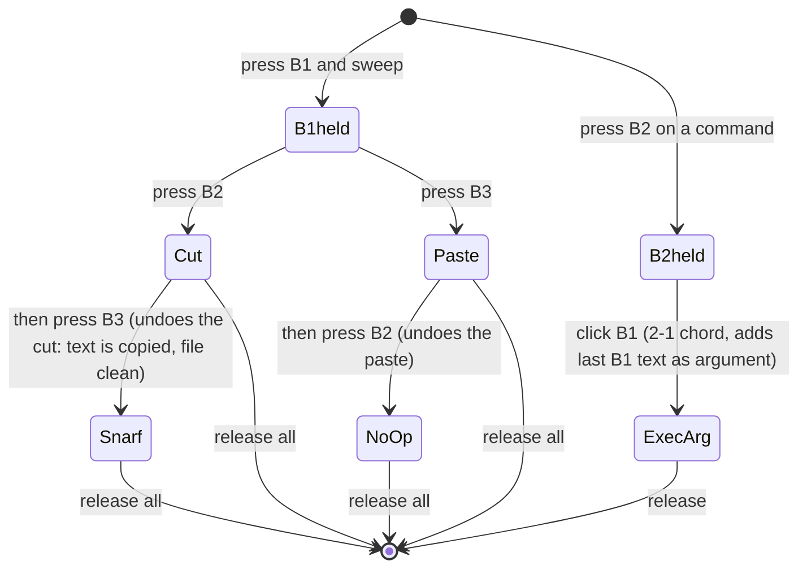
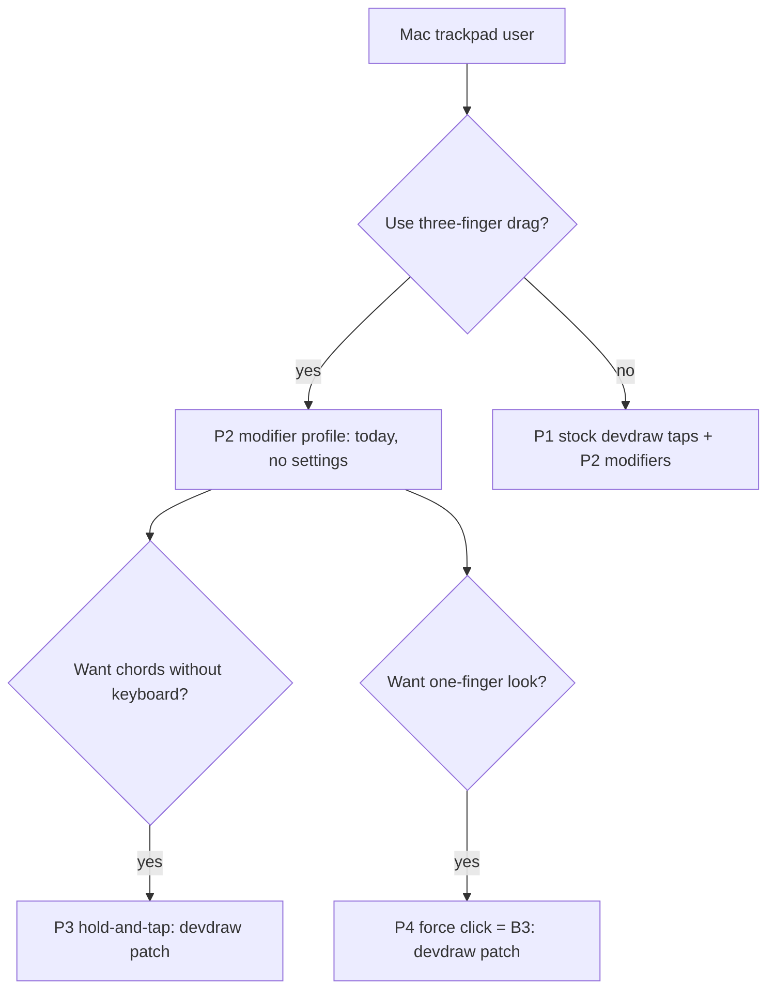

# snarf input mapping guide: mouse, Magic Mouse, Magic Trackpad

*SnarfProdd (PM) working note, 2026-10-11, written as **future user-guide material**. It is not an agreed requirement. The authoritative sources are [R-02](../../../docs/requirements/02-editor-functional.md) (R-EDIT-05..09, 24, 25), [R-05](../../../docs/requirements/05-input.md) (R-IN-01..08) and [ADR-0004](../../../docs/spec/adr/0004-three-button-mouse.md)/[ADR-0005](../../../docs/spec/adr/0005-two-hosts-one-core.md). It reuses [touchpad research](../../../docs/product/research/touchpad-interaction.md).*

*Scope: the **native host** (primary, per the ADR-0005 amendment) on macOS, with plan9port `devdraw` as the display and input server. The browser host is frozen, so browser mappings appear only as notes.*

**Evidence tags:**
- **[V]** verified in a primary source: acme(1), Pike's paper, repo requirements, or the pinned `larryr/plan9port@337c6ac` devdraw source (`src/cmd/devdraw/mac-screen.m`, `mouseswap.c`).
- **[I]** inferred, or not yet tried on hardware.
- **[L]** reported by Larry.

---

## 1. The canonical reference: acme's three-button mouse

Everything else in this guide is an *emulation* of this table. On the native host, devdraw delivers real three-button records to snarf's unchanged core. Snarf's own emulation profiles (R-IN-04..07) are a browser-host feature (ADR-0005, phase-15 findings) **[V]**.

### 1.1 Buttons

| Button | Name | Click | Sweep (press, drag, release) | Double-click | Source |
|---|---|---|---|---|---|
| **B1** (left) | select | Sets the caret (dot) | Selects text | Selects a word, a line, or a bracketed or quoted range by context | acme(1) §"Mouse button 1"; R-EDIT-05 **[V]** |
| **B2** (middle) | execute | Runs the *expanded* word under the pointer: a click inside the B1 selection uses that selection, otherwise it uses the largest run of file-name characters | Runs the swept text as a command. The first word is the command, the rest are arguments | Not needed; one click expands | acme(1) §"Mouse button 2"; R-EDIT-06, R-EDIT-24 **[V]** |
| **B3** (right) | look | Expands like B2. If the text names a file or window it is opened, otherwise acme searches for it. Repeated clicks step through matches | Looks up the swept text | — | acme(1) §"Mouse button 3"; R-EDIT-07 **[V]** |

The scroll bar works differently: B1 scrolls up, B3 scrolls down, and B2 jumps to an absolute position (R-EDIT-04) **[V]**. The wheel sends buttons 4 and 5 (devdraw(1)) **[V]**. Shift+B3 is button 8, a reverse search (devdraw(1)) **[V]**.

### 1.2 Chords

| Chord | How | Effect | Source |
|---|---|---|---|
| **1-2** | Select with B1, keep B1 down, press B2 | **Cut** | acme(1) §"Chords of mouse buttons" **[V]** |
| **1-3** | Select with B1, keep B1 down, press B3 | **Paste** (replaces the selection) | same **[V]** |
| **1-2-3** | Keep B1 down, press B2 then B3 | **Snarf** (copy) and *leave the file unmodified*. "After clicking one button, the other undoes the first", so cut followed by paste puts the text back but leaves it in the snarf buffer | acme(1): "2 followed by 3 is a Snarf that leaves the file undirtied" **[V]** |
| 1-3-2 | Keep B1 down, press B3 then B2 | **No-op** (paste then undo the paste) | acme(1): "3 followed by 2 is a no-op" **[V]** |
| **2-1** | Hold B2 on a command and click B1 | Runs the command with **the text last pointed to by B1** as an extra final argument. Example: point at `text`, then B2 `Look` while clicking B1 | acme(1) §"Chords"; R-EDIT-08 **[V]** |

Chords also apply to text selected by double-click, because the expansion happens when the second click *starts* (acme(1)) **[V]**.

*Doc nit for a future R-EDIT-08 pass **[I]**:* R-EDIT-08 calls 1-2-3 "B1+B2 then B3 without release = Snarf-and-paste idioms". acme(1) is more precise: it is a Snarf that leaves the file clean.

### 1.3 Warp (acme moves the pointer for you)
- **New window:** the pointer moves to the selected text in it.
- **B3 opens a file or window:** the pointer moves to that window's selection.
- **Deleting a newly made window:** the pointer returns to where it was.
- **Clicking a layout box:** the pointer follows the box, so repeated clicks keep growing the window.

Sources: Pike's paper (`docs/acme/acme.md` ~l.380-392), acme(1) §"Mouse button 3", R-EDIT-25 **[V]**. Snarf's core requests every warp by writing `/dev/mouse`, and each host decides whether to honour it (R-EDIT-25, `src/core/warp.zig`) **[V]**.

---

## 2. Apple Magic Mouse

**Hardware:**
- One physical click.
- A multi-touch top surface.
- macOS can treat a click on the right side as a secondary click.
- There is **no middle button** (Apple, "Use Multi-Touch gestures on Mac") **[V]**.

**How devdraw maps it** (pinned source, `getmouse`/`flagsChanged`/`scrollWheel`, plus devdraw(1)):

| Action | Arrives as | Source |
|---|---|---|
| Click (left or anywhere) | **B1** | `NSEvent pressedMouseButtons` bit 0 **[V]** |
| **Option-click** | **B2** | `getmouse`: if B1 and Option, then B2 **[V]** |
| **Command-click** | **B3** | `getmouse`: if B1 and Command, then B3 **[V]** |
| Right-side click (if macOS secondary click is on) | **B3** | `rightMouseDown` → `getmouse`. The right-button bit is remapped to 4 (B3) **[V]**. Whether the setting is on by default: **[I]**, check System Settings → Mouse |
| Holding B1, then press **Control / Option / Command** | adds **B1 / B2 / B3**, which makes the chord | `flagsChanged` **[V]** |
| Shift + any click | button + 5 (e.g. Shift+B3 = 8, reverse search) | **[V]** |
| One-finger slide | Scroll (buttons 4 and 5) | `scrollWheel` **[V]** |
| Multi-finger taps | **Nothing.** devdraw's finger-tap code reads `NSTouch`, which is a trackpad path | **[I]**: Magic Mouse surface touches don't appear to reach `NSTouch` |

**The chords on a Magic Mouse:**
- **Cut:** sweep with a click, then Option.
- **Paste:** sweep, then Command.
- **Snarf:** sweep, then Option, then Command.
- **2-1:** Option-click on the command, keep holding, then press Control.

**macOS settings:** none are required. Optionally turn on "Secondary click: Click on right side" for a one-handed B3. Also, `$mousebuttonmap` (an environment variable read by `mouseswap.c`) can remap button numbers, for example so that right-click means B2 **[V]**: the source reads it, but **[I]** no one has tried this.

---

## 3. Apple Magic Trackpad and MacBook Force Touch trackpads: profiles

Larry uses **macOS three-finger drag** **[L]**. In Apple's design, enabling it moves Look up to force click and moves other three-finger swipes to four fingers (Apple 102482, footnote 2) **[V/I]**. It also makes three-finger *taps* unreliable for him **[L]**.

### P1: stock macOS + devdraw (works today; conflicts with three-finger drag)

| Gesture | Button | Source |
|---|---|---|
| 1-finger click | B1 | **[V]** |
| 2-finger click or tap (secondary click) | **B3** | `rightMouseDown` → B3 **[V]** |
| **3-finger tap** (under 250 ms, no movement) | **B2** click | `touchesEndedWithEvent`, case 3 **[V]** (commit `9af9ceca`) |
| **4-finger tap** | **2-1 chord** (B2, then B2+B1, then release) | case 4 **[V]** |
| Option-click / Command-click, and mid-click modifiers | B2 / B3, plus chords | as on the Magic Mouse **[V]** |
| 2-finger scroll | buttons 4 and 5 | **[V]** |
| Pinch | toggles full screen | `magnifyWithEvent` **[V]** |

- **macOS settings required:** turn **three-finger drag off**. Also turn off "Look up & data detectors: Tap with three fingers", or set it to force click, so macOS doesn't claim the tap **[I]**.
- **Pros:** zero code. B2 clicks and 2-1 need no keyboard.
- **Cons:** there are **no B2 sweeps** (a tap is only a click) and no cut or paste chords without modifiers. **Breaks Larry's three-finger drag.** Four-finger taps can collide with Mission Control gestures **[I]**.

### P2: modifier profile (works today, no macOS changes) ← **recommended default for Larry**

| Gesture | Button / chord |
|---|---|
| 1-finger click / sweep | B1 click / sweep |
| Option + click / sweep | **B2** click / sweep (execute) |
| Command + click / sweep, *or* 2-finger click | **B3** click / sweep (look) |
| Sweep with a click held, then **Option** | **1-2 Cut** |
| Sweep held, then **Command** | **1-3 Paste** |
| Sweep held, then Option, then Command | **1-2-3 Snarf** |
| Option-click on a command, held, then **Control** | **2-1** argument chord |
| Also available | Cmd-X / Cmd-C / Cmd-V / Cmd-Z, which acme(1) calls "much less awkward than the equivalent chords" on laptops |

Sources: devdraw(1), acme(1) §"Simulated buttons", `flagsChanged` **[V]**.

- **macOS settings required:** none. It **coexists with three-finger drag**.
- **Pros:** covers the *entire* acme grammar today, including B2 *sweeps*. It is the same model as snarf's browser `modifier` profile (R-IN-05) and Oberon's Ctrl-as-middle-button.
- **Cons:** one hand on the keyboard for B2 and chords. Holding a physical click while pressing a key gets tiring during long sweeps.

### P3: hold-and-tap chords (needs a devdraw patch)

| Gesture | Button / chord |
|---|---|
| Physical click held (the anchor) + **tap one other finger** | During B1: **+B2 (Cut)**. During B2: **+B1 (2-1)** |
| Anchor + **tap two fingers together** | During B1: **+B3 (Paste)** |
| Anchor + tap 1, then tap 2 | 1-2-3 **Snarf** |
| Everything in P2 | unchanged (modifiers still work) |

- **macOS settings required:** none expected, because the anchor is a physical click, not a tap **[I]**. This needs verifying alongside three-finger drag.
- **Implementation:** a patch to `touchesBegan/Ended` in **devdraw** in Larry's `larryr/plan9port` fork. Snarf's build would then re-pin to it (ADR-0006, PR #3, which proposes building the pinned devdraw). There is no snarf core change (R-IN-02 holds) **[V]**. This is the same grammar R-IN-06 specifies for touch screens **[V]**. Prior research suggests trying it in a day with Hammerspoon first **[I]**.
- **Pros:** chords without the keyboard. Works with three-finger drag.
- **Cons:** costs a patch. A resting finger might be read as a tap. Two-finger contact may be read as a secondary click **[I]**.

### P4: force click as B3 look (needs a devdraw patch; optional add-on)

| Gesture | Button |
|---|---|
| Force click (pressure stage 2) without dragging | **B3** click (look) on the expanded word |

- **macOS settings required:** "Force Click and haptic feedback" must be on. "Look up: Force click with one finger" should be **off**, or macOS may claim the gesture **[I]**.
- **Implementation:** a devdraw patch using `NSEvent` pressure stages **[V: API]**. Never map force click to B2, because an accidental press would execute text.
- **Pros:** one-finger look, like Apple's own force-click Look up.
- **Cons:** pressure thresholds vary from person to person. MacBook and Magic Trackpad (Force Touch models) only.

### P5: dual trackpad (left hand as a chord pad): PARKED
A second Magic Trackpad under the left hand would act as three button zones. It needs the private `MultitouchSupport.framework`, and both pads move the same pointer. **Parked** unless multitouch adds something a modifier key can't, given the cost of taking both hands off the keyboard (sync decision) **[L]**.

### Comparison matrix

| | P1 stock | **P2 modifier** | P3 hold-and-tap | P4 force-B3 | P5 dual pad |
|---|---|---|---|---|---|
| Works today | ✅ | ✅ | ❌ devdraw patch | ❌ devdraw patch | ❌ private API |
| macOS changes | **Yes**: three-finger drag off, Look up off | **None** | None expected [I] | Look up off [I] | Unknown |
| Compatible with three-finger drag | ❌ | ✅ | ✅ [I] | ✅ | ? |
| B2 click / B2 sweep | ✅ / ❌ | ✅ / ✅ | ✅ (via P2) | — | ✅ |
| 1-2, 1-3, 1-2-3 chords | via modifiers | ✅ | ✅ no keyboard | — | ✅ |
| 2-1 chord | ✅ 4-finger tap | ✅ Option+Control | ✅ | — | ✅ |
| Hands off keyboard | Mostly | No | Mostly | Yes | Both hands |
| Effort | 0 | 0 | M | S | L |

**Recommended default for Larry: P2**, plus the 2-finger click as B3. It works today, needs no macOS changes, and keeps three-finger drag. P3 is the planned upgrade (roadmap M3, trackpad D1). P4 is an optional add-on.

---

## 3a. Anvil (parked): optional chord pad

*Larry named it on 2026-10-30, after the ACME company catalogue in the Looney Tunes cartoons, which is where acme's name comes from [L].* **Status: PARKED** until the M5 attention feature exists (R-AG-22..27 in the [M5 draft](../requirements/m5-ai-harness-requirements-draft.md) §5a). Anvil is an **optional input profile**, like P1–P5. It is never a requirement.

**What it is:**
- A small desk pad beside the trackpad. It could be an off-the-shelf USB or Bluetooth macro pad, or a custom QMK board.
- It sends **ordinary key codes**, so snarf and macOS need **no drivers**. Each key just emits a binding that snarf already has.
- Remapping happens in the pad's firmware or configurator, not in snarf.

**Lineage:** Engelbart's five-key chord keyset, used beside the mouse in the 1968 demo: the left hand chords commands while the right hand points.

**Off-hand device (Larry, 2026-10-30):**
- Anvil is used by the **hand opposite the mouse or trackpad**, which matches Engelbart's keyset-plus-mouse setup.
- For example: left hand on Anvil, right hand on the trackpad. Jump, approve and back then never require lifting either hand.
- The **key layout SHALL be mirrorable** for left- or right-handed use, by flipping the layout in firmware or the configurator. snarf sees the same key codes either way.

**Candidate keys:**

| Anvil key | Action | Same action without Anvil (required) |
|---|---|---|
| Jump | Go to the next pending agent request (R-AG-25) | The jump key or modifier+click chosen with R-IN-06 |
| Approve | Approve the request the pointer is on (R-AG-22) | The keyboard or B2 binding defined with R-AG-22 (open question 10 in the M5 draft) |
| Deny | Deny that request | Same as Approve |
| Back | Return to the prior editing spot (R-AG-26) | `Del` on the request window, or the jump gesture after the newest request |
| *Optional:* B1 / B2 / B3 | acme buttons and chords | P2 modifiers (Option = B2, Command = B3) and 2-finger click = B3 |

On the optional button keys: plain key codes are **not** mouse buttons. B1/B2/B3 keys would need either the pad sending HID mouse-button reports (QMK can do this), or the key codes mapped onto the P2 modifiers **[I]**. How devdraw handles mouse buttons 3+ from a non-Apple device is untried **[I]**.

**Hard rules:**
1. **The laptop method stays complete.** Every Anvil action SHALL also be a keyboard or trackpad binding on a bare MacBook. No action may be Anvil-only.
2. **No three-finger gestures** anywhere in the Anvil profile or its fallbacks, because Larry uses three-finger drag [L].
3. No drivers and no private APIs. If a pad needs vendor software to emit plain key codes, that software runs outside snarf.

**Pros:**
- One-hand triage of agent requests without leaving the pointing hand.
- Engelbart-style chording.
- Cheap, and reversible.

**Cons:**
- More desk hardware.
- Another layout to learn.
- Useless until M5's attention queue exists.

## 4. Warp per device

| Host / device | Warp | Notes |
|---|---|---|
| Native, any device (mouse, Magic Mouse, trackpad) | **Real.** `CGWarpMouseCursorPosition` plus `CGAssociateMouseAndMouseCursorPosition(true)` in devdraw `setmouse` **[V]** | Pointing devices are relative, so a warp never fights the hand. On a trackpad, the next finger movement continues from the new spot **[I]** |
| Native: return after `Del` | **Not yet:** `savemouse`/`restoremouse` is unported (R-EDIT-25). It is a headless-testable micro-item in roadmap M0 **[V]** | Will work on every device once ported |
| Native: layout and scroll warps | Unported on both hosts (R-EDIT-25) **[V]** | — |
| Browser (frozen) | **None.** The write is refused (`src/dev/input.zig`) and acme shows the target instead **[V]** | Pointer Lock is parked |
| Wayland (future) | No pointer warping. `Tmoveto` is a documented no-op (ADR-0005) **[V]** | — |

Possible future refinements, from the touchpad research **[I]**: an animated warp of about 120 ms with a destination ring, and a haptic tick on Force Touch pads.

## 5. Open questions
1. **R-IN-06 alignment.** R-IN-06 (the browser touch profile) says 2-finger tap = B2 and 3-finger tap = B3. macOS and devdraw use 2 = B3 and 3 = B2. Proposal: align it to macOS/devdraw. This is a text-only fix, the touch profile is frozen, and it needs a PR when Larry wants it.
2. Does a **3-finger tap** reach devdraw at all with three-finger drag on? Larry reports it's unreliable **[L]**. A 5-minute hardware check would confirm whether P1 is impossible or just flaky for him.
3. Is the Magic Mouse right-side secondary click on by default? Does `$mousebuttonmap` work as expected (for example, right = B2)? These need hands-on checks.
4. P3: would an "anchor lock" (click and release to keep B1 held during long sweeps) help, or would it confuse?
5. Should the eventual user guide ship one per-device "cheat card" alongside the Mac keyboard shortcuts?

## Revision log
- **2026-10-11:** first version (SnarfProdd).
- **2026-10-30:** added §3a, *Anvil (parked): optional chord pad*. Larry chose the name. It is a key-code-only macro pad for agent-request jump/approve/deny/back, plus optional B1–B3. Laptop parity is a hard rule, and it has no three-finger gestures.
- **2026-10-30:** §3a states that Anvil is an off-hand device, used by the hand opposite the mouse or trackpad (Larry), with a layout mirrorable for left- or right-handed use.
